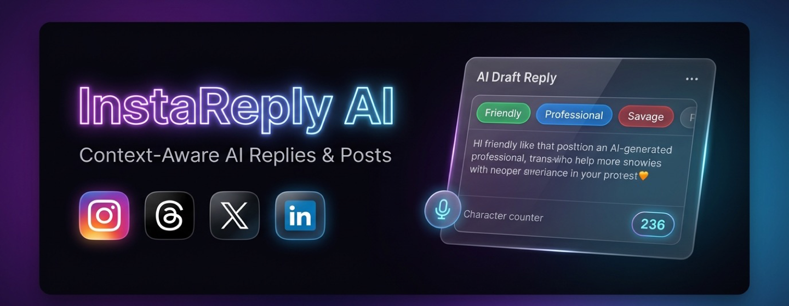

<p align="center">
  
</p>

# InstaReply AI - Smart Assistant for Instagram, Threads, X (Twitter), LinkedIn & Facebook

<p align="center">
  <a href="https://chromewebstore.google.com/detail/instareply-ai-social-medi/gjgoiomoldgokbajlbepelpkidnbnpmg"></a>
  <a href="https://github.com/seventhmoon/insta-reply-extension/actions/workflows/ci.yml"></a>
  <a href="https://github.com/seventhmoon/insta-reply-extension/releases"></a>
  <a href="https://img.shields.io/badge/Manifest-V3-success?style=flat"></a>
  <a href="LICENSE"></a>
  <a href="https://github.com/sponsors/seventhmoon"></a>
</p>

A high-performance Google Chrome Extension (Manifest V3) that injects an intelligent, contextual AI assistant directly into **Instagram** (Comments, Reels, DMs, Stories), **Threads** (Post Replies, Thread Conversations), **X / Twitter** (Tweets, Replies, DMs), **LinkedIn** (Feed, Comments, InMail), **Facebook**, and **Meta Business Suite**. Available on the [Chrome Web Store](https://chromewebstore.google.com/detail/instareply-ai-social-medi/gjgoiomoldgokbajlbepelpkidnbnpmg).

---

## ✨ Core Features

<a id="supported-platforms"></a>
### 🌐 Multi-Platform Social Media Support
- **Meta Threads**: Injects into Threads post reply boxes and composers with 500-character boundary limits, thread context extraction, and conversation starter assistance.
- **X (Twitter)**: Directly injects into tweet composers (`div[data-testid="tweetTextarea_0"]`) and reply toolbars, with strict 280-character boundary enforcement, tweet context parsing, and thread author detection.
- **LinkedIn**: Contextual replies for feed posts, comments (`.comments-comment-box`), and InMail messages with professional networking tone bias.
- **Facebook**: Works seamlessly in Facebook feed comments and group discussions with warm, community-friendly responses.
- **Meta Business Suite**: Handles unified inbox comments, direct messages, and creator post composers.
- **Universal ContentEditable Engine**: Natively supports React, Draft.js, and Lexical rich-text editors without breaking internal state, undo history, or cursor position.

### ⚡ 1-Click Zero-Dialog Quick Reply
- **Direct Insertion**: Press <kbd>Alt</kbd>+<kbd>Q</kbd> (or <kbd>Option</kbd>+<kbd>Q</kbd> on macOS) to instantly generate and insert an AI reply into the focused input without opening the card dialog.
- **In-Flight Lock Protection**: Prevents duplicate API requests during generation.

### 📸 Instagram Stories & Story DM Replies
- **Seamless Story Composer Shortcut**: Injects a branded shortcut button into the Story reply pill on desktop web, supporting standard and localized placeholders (*"Reply to..."*, *"Send message..."*, *"Responder..."*, *"メッセージ..."*).
- **Active Slide Isolation**: Scopes extraction strictly to the active slide, preventing multi-slide carousel bleed or background feed post pollution.
- **Smart Story Text Extraction**: Extracts text stickers overlaid on the slide while ignoring Instagram system elements (emoji *"Quick Reactions"* trays and navigation CTAs like *"Watch full reel"* or *"View post"*).
- **Shared Reel & Post Awareness**: Automatically detects when a story is sharing a Reel or Post, identifying the original creator and describing the visual context.
- **Auto-Pauses Story Playback**: Automatically pauses the Story timer and video while the assistant card is open, and resumes playback upon closing.
- **Safe React Input Insertion**: Handles prototype setter resolution between `HTMLInputElement` and `HTMLTextAreaElement` without `TypeError: Illegal invocation`, cleanly updating React internal state.

### 💬 Post & Reel Comments
- **Inline Shortcut Button**: Placed right beside native "Post" / "Reply" buttons with configurable button styles (*Auto*, *Standard*, *Icon-Only*).
- **Comment-Level "✨ AI Reply" Chips**: Injected next to each comment's "Reply" button for 1-click targeted responses.
- **Reels Drawer Isolation**: Distinguishes comments drawer contents from the main Reel background container, preventing metadata cross-contamination.
- **Creator vs. Fan Perspective**: Automatically detects if you are the author of the post (speaking warmly in 1st person) or a visitor participating in the conversation.

### ✉️ Direct Messages (Fullscreen & Mini-Window PIP)
- **Omnipresent DM Support**: Works in both fullscreen threads and floating picture-in-picture (PIP) chat windows.
- **Message Bubble Chips**: Inline "✨ AI Reply" chips on received incoming messages.
- **Conversation Context**: Understands recent message context and addresses the sender naturally.

### 👁️ Visual Scene & Multimodal Vision
- **Multimodal Image Support**: Directly analyzes post/reel photos using the Gemini Vision API and OpenAI-compatible vision models.
- **Computer Vision Alt Parsing**: Parses accessibility scene descriptions and video posters to ground replies in visual elements.

### 🎙️ Voice Mimicry & Anti-Troll Shield
- **Personal Voice Mimicry**: Provide your own sample messages (`myVoiceSamples`) to train the AI to mimic your unique vocabulary, capitalization, and cadence via few-shot prompting.
- **Anti-Troll Shield**: Automatically classifies incoming comments for spam, trolling, or harassment, filtering out bad-faith interactions.

### 🎯 Customization & Control
- **1-Click Stance Selector**:
  - `🟢 Positive` (Supportive, appreciative, encouraging)
  - `⚪ Neutral` (Objective, informative, balanced)
  - `🔴 Negative` (Polite boundaries, decline, disagreement)
- **Extended Tone Presets**: Quick-switch between *Friendly, Funny, Playful, Savage, Geek, Spicy, Hyped, Professional, Empathetic, Short*, and extended styles (*Flirty, Seductive, Evil, Mean*).
- **Zero-Latency Multi-Tone Bundling**: Bundles tone drafts in a single AI request for instant tone switching with zero extra API calls.
- **Multi-Language Support**: Choose your response language (*Auto-Detect / Match Context, English, Spanish, French, German, Italian, Portuguese, Japanese, Traditional Chinese, Simplified Chinese, Korean*).
- **Draft Hint Steering**: Type a quick thought into the reply box (e.g., *"friendly decline and ask for email"*), and InstaReply will follow your guidance.
- **Draggable & Resizable UI**: In-page assistant card and popup can be freely moved and resized with viewport boundary clamping and localStorage persistence.

---

## 🤖 Supported AI Providers

| Provider | Description | Recommended Models |
| :--- | :--- | :--- |
| **Google Gemini** | Official API with dynamic model list fetching & multimodal vision. | `gemini-2.0-flash`, `gemini-1.5-flash`, `gemini-1.5-pro` |
| **Groq Cloud** | Ultra-high-speed LPU inference (free tier available). | `llama-3.3-70b-versatile`, `llama-3.1-8b-instant`, `mixtral-8x7b-32768` |
| **OpenRouter** | Multi-model gateway with free tiers. | `meta-llama/llama-3.3-70b-instruct:free`, `deepseek/deepseek-r1:free`, `qwen/qwen-2.5-72b-instruct:free` |
| **Custom OpenAI-Compatible** | Any OpenAI-spec API (GitHub Models, Mistral AI, Azure, DeepSeek). | `gpt-4o-mini`, `mistral-small-latest`, custom endpoints |
| **Local LLM** | Self-hosted offline models via Ollama or LM Studio. | `llama3.2`, `mistral:latest`, `qwen2.5:7b` |
| **Edge AI (Gemini Nano)** | On-device private inference via Chrome Built-in Prompt API. | Chrome Prompt API (`chrome://flags/#prompt-api-for-gemini-nano`) |

---

## 🚀 Installation Guide

### Option 1: Install from Chrome Web Store (Recommended)

Install the latest official release directly from the Chrome Web Store:

👉 **[Install InstaReply AI on Chrome Web Store](https://chromewebstore.google.com/detail/instareply-ai-social-medi/gjgoiomoldgokbajlbepelpkidnbnpmg)**

---

### Option 2: Load Unpacked from Source (Developer Mode)

1. Clone this repository:
   ```bash
   git clone https://github.com/seventhmoon/insta-reply-extension.git
   cd insta-reply-extension
   ```
2. Open Google Chrome and navigate to `chrome://extensions`.
3. In the top-right corner, enable **Developer mode**.
4. Click **Load unpacked**.
5. Select the `insta-reply-extension` directory.
6. The **InstaReply AI** icon will appear in your Chrome toolbar.

### 2. Configure Your AI Provider

1. Click the **InstaReply AI** icon in your Chrome toolbar.
2. Select your provider:
   - **Gemini API**: Paste your API key from [Google AI Studio](https://aistudio.google.com/app/apikey) and click **Fetch Latest Models**.
   - **Groq API**: Paste your key from [Groq Console](https://console.groq.com/keys).
   - **OpenRouter**: Paste your key from [openrouter.ai](https://openrouter.ai/keys).
   - **Local LLM**: Ensure Ollama or LM Studio is running (e.g. `http://localhost:11434/v1`) and click **Fetch Local Models**.
3. Click **Test Connection** to verify your setup.
4. Customize your default stance, tone, language, and custom persona rules, then click **Save Settings**.

---

## 🧪 Testing & Verification

InstaReply AI includes a comprehensive test harness covering unit logic, regression edge cases, and real DOM integration across **15 test suites and 60+ automated tests**:

### Automated Test Suite
Run the test suite with Node.js:
```bash
npm test
# or directly:
node test/automated-tests.js
```

The test runner validates:
- **Suite 1: Syntax & Manifest Quality**: Validates all scripts and Manifest V3 structure.
- **Suite 2: Dedicated Post Context Extraction**: Canonical author detection, semantic caption parsing, visual thumbnail filtering.
- **Suite 2b: Instagram Reel Extraction**: Shortcode resolution, comments drawer isolation, reel video visuals.
- **Suite 2c: Instagram Story Reply & Context Extraction**: Multilingual input detection, active slide scoping, React prototype setters, button re-injection, reaction tray exclusion, and shared Reel CTA rejection.
- **Suite 3: Comment Isolation & Anti-Stale Caching**: Thread scoping and cache eviction.
- **Suite 4: Multi-Tone Bundling & AI Response Parsing**: Markdown fence stripping, JSON parsing, LRU caching, and throttled prefetching.
- **Suite 5: Real Headless Chrome DOM Integration**: Automated headless Chrome test executing against `test/browser-test-runner.html`.
- **Suite 6: Multi-Provider (Groq, OpenRouter, Custom OpenAI) & Combobox**: Endpoint normalization, OpenRouter headers, and vision payload formatting.
- **Suite 7: Voice Mimicry, Anti-Troll Shield & Draggable Card**: Few-shot prompt injection, spam classification schema, and draggable UI controls.
- **Suite 8: 1-Click Quick Reply Flow**: Zero-dialog direct insertion, in-flight lock safety, and shortcut detection.
- **Suite 9: Desktop Tone Navigation & Spacious Layout**: Desktop chevrons, mouse wheel scroll, grab drag, and grid view toggle.
- **Suite 10: Resizable Toolbar Popup & Assistant Card**: Drag handles, boundary clamping, and local storage persistence.
- **Suite 11: GitHub Sponsors & Community Funding Integration**: Sponsorship links across popup, assistant card, and docs.
- **Suite 12: Comment Button Style, Compact Icon Mode & Layout Protection**: Auto-compacting and icon-only loading states in action rows.
- **Suite 13: Multi-Platform Domain Routing (X, LinkedIn, Facebook, Threads)**: Platform detection and adapter resolution across all supported sites.
- **Suite 14: Multi-Platform Context Extraction & Prompt Constraints**: Platform-specific lengths (280 chars for X, 500 chars for Threads) and tone bias.
- **Suite 15: Post Drafting, Toolbar Placement & LinkedIn Message Handling**: Toolbar injection, post drafting detection, and action chip pruning.

### In-Browser Interactive Testing
Run tests visually in Chrome without logging in:
- **Interactive DOM Test Runner**:
  ```bash
  open test/browser-test-runner.html
  ```
- **Simulated Instagram Interface**:
  ```bash
  open test/mock-instagram.html
  ```

---

## 📁 Project Structure

```text
insta-reply-extension/
├── .github/
│   ├── workflows/             # GitHub Actions CI & Release workflows
│   ├── ISSUE_TEMPLATE/        # Bug report & feature request issue forms
│   ├── PULL_REQUEST_TEMPLATE.md # PR checklist & template
│   └── FUNDING.yml            # GitHub Sponsors configuration
├── manifest.json              # Chrome Extension Manifest V3 configuration
├── background/
│   └── service-worker.js     # Background service worker for LLM API calls, cache & storage
├── content/
│   ├── adapters/              # Multi-platform context & injection adapters
│   │   ├── platform-detector.js   # Domain & hostname routing engine
│   │   ├── threads-adapter.js     # Meta Threads adapter (500-char limits)
│   │   ├── x-adapter.js           # X / Twitter adapter (280-char enforcement)
│   │   ├── linkedin-adapter.js    # LinkedIn feed, comment & InMail adapter
│   │   ├── facebook-adapter.js    # Facebook feed & comment adapter
│   │   └── meta-business-adapter.js # Meta Business Suite inbox & toolbar adapter
│   ├── content.js             # Content script: DOM injection, Story/Reel scoping & event handlers
│   ├── content.css            # Extension styling, dark mode floating assistant card & buttons
│   └── page-bridge.js         # Page-context bridge for native React DOM interactions
├── popup/
│   ├── popup.html             # Extension settings UI with provider combobox
│   ├── popup.css              # Settings popup styling
│   └── popup.js               # Settings controller & API connection testing
├── rules/
│   └── rules.json             # Declarative net request rules for CORS stripping
├── test/
│   ├── automated-tests.js     # Automated test suite (15 suites, 60+ tests)
│   ├── browser-test-runner.html # Headless Chrome DOM integration test harness
│   └── mock-instagram.html    # Interactive Instagram UI test simulator
├── scripts/
│   └── package.sh             # Build script for clean Chrome Web Store zip packaging
├── promo/                     # Promotional graphics and store banners
├── icons/                     # Extension toolbar icons (16px, 48px, 128px)
├── CHANGELOG.md               # Version history and release notes
├── CONTRIBUTING.md            # Guidelines for open source contributors
├── SECURITY.md                # Vulnerability disclosure and security policy
├── PRIVACY.md                 # Privacy policy
├── CHROMEWEBSTORE.md          # Store listing copy & submission notes
├── LICENSE                    # GNU General Public License v3.0
├── package.json               # Test script and package configuration
└── README.md                  # Project documentation
```

---

## 🔒 Privacy & Permissions

- **Direct Client-to-API**: All AI calls are made directly from your browser's service worker to your selected AI provider. No intermediate backend server is used.
- **Local Storage**: API keys, preferences, and cached responses are stored securely in Chrome's local extension storage.
- **Platform Scoped**: Active only on supported social platforms (`instagram.com`, `threads.net`, `x.com`, `twitter.com`, `linkedin.com`, `facebook.com`, `meta.com`).
- **No Tracking**: We do not track, log, analyze, or sell any of your browsing activity or message data. See [PRIVACY.md](PRIVACY.md) for full details.

---

## 💖 Support & Sponsorship

If InstaReply AI saves you time and enhances your workflow, consider supporting ongoing development, new models, and maintenance:

[](https://github.com/sponsors/seventhmoon)

---

## 📄 License

This project is licensed under the terms of the GNU General Public License v3.0 (GPLv3). See [LICENSE](LICENSE) or [LICENSE.md](LICENSE.md) for the full license text.
